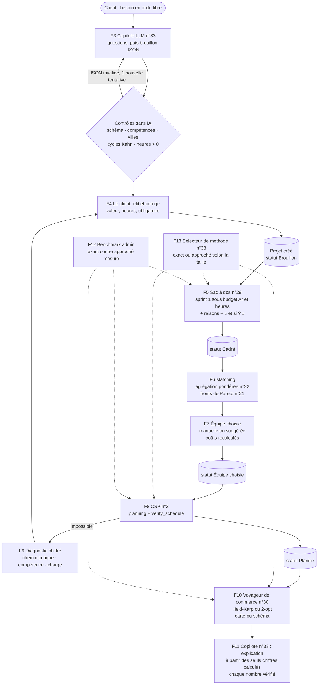

# 03 — Fonctionnalités

Ce document décrit chaque fonctionnalité de SmartBricks **telle qu'elle existe dans le code** : le besoin du client auquel elle répond, ce que voit l'utilisateur, les données qu'elle produit, et comment elle s'enchaîne avec la suivante. Le schéma final résume l'enchaînement complet.

Rappel du principe : le **copilote** (modèle de langage) dialogue, structure et explique ; les **algorithmes** décident de tout ce qui est chiffré. Le copilote ne calcule jamais un budget, un planning ou une tournée.

---

## F1. Connexion et comptes

**Besoin.** Un client veut retrouver ses projets, et seulement les siens ; un administrateur doit pouvoir surveiller le système.

**Ce que voit l'utilisateur.** La page `/connexion` : un formulaire email + mot de passe, et deux boutons « comptes de démonstration » (la cliente Soa, l'administrateur) qui connectent en un clic.

**Données produites.** Un jeton JWT (`POST /auth/login`), stocké dans le navigateur, envoyé ensuite dans l'en-tête `Authorization: Bearer …`. Les mots de passe sont hachés avec argon2 (`backend/app/security.py`). Trois rôles existent : `CLIENT`, `FREELANCER`, `ADMIN` ; on ne peut pas s'inscrire soi-même comme administrateur.

**Enchaînement.** Toutes les routes suivantes exigent ce jeton. Un client ne voit que ses projets (`403` sinon) ; l'administrateur voit tout, et lui seul accède au benchmark et à la consommation du LLM.

---

## F2. Tableau de bord

**Besoin.** Savoir où en est chaque projet dans le parcours et reprendre là où on s'est arrêté.

**Ce que voit l'utilisateur.** Quatre chiffres (projets, budget total déclaré, étapes franchies, mode du copilote), une carte par projet avec son statut (`Brouillon`, `Cadré`, `Équipe choisie`, `Planifié`), une barre de progression « en briques » sur les 6 étapes, et un bouton « Continuer » vers la prochaine étape. L'encadré « Qui décide quoi ? » associe chaque étape à son algorithme du cours. En développement, un bouton « Réinitialiser la démo » recrée les données.

**Données produites.** Aucune : il lit `GET /projects` et `GET /health`.

**Enchaînement.** Le statut du projet, mis à jour par chaque étape, pilote l'état des étapes dans la barre latérale (fait / en cours / à venir).

---

## F3. Copilote : du besoin en texte libre au brouillon (module A, n°33)

**Besoin.** Le client ne sait pas traduire son idée en fonctionnalités, tâches et compétences. Il décrit son projet avec ses mots.

**Ce que voit l'utilisateur.** L'écran `/copilote` en deux colonnes :
- à gauche, la conversation. Le copilote pose **une question à la fois** tant qu'il manque le budget, la date limite, la ville de base ou des fonctionnalités clés ; des réponses rapides sont proposées (« Oui, livraison à domicile », « Utiliser l'exemple Boutique Soa ») ;
- à droite, dès que le copilote a assez d'informations, le **brouillon** : intitulé, budget, heures du sprint, date limite, ville de base ; chaque fonctionnalité (« brique ») avec un curseur de valeur métier, ses heures, sa case « obligatoire » ; les tâches repliées ; les villes à visiter ; les corrections automatiques faites par le serveur.

Le client **corrige** ce qu'il veut, puis clique « Valider le brouillon ».

**Données produites.**
- Par `POST /assistant/chat` : la réponse du copilote, et quand il est prêt, un brouillon JSON validé (`Draft` dans `backend/app/llm/draft.py`) : projet, fonctionnalités (ref, titre, type, valeur 1–100, heures, obligatoire, dépendances), tâches (ref, fonctionnalité, compétence, niveau 1–5, heures, dépendances, ville sur site), sites. La conversation et le brouillon sont enregistrés (`assistant_conversations`, `assistant_messages`).
- Par `POST /assistant/confirm` : le projet en base (`projects`, `features`, `tasks`, `task_dependencies`, `project_sites`), avec le **coût estimé** de chaque fonctionnalité = Σ (heures de chaque tâche × taux horaire moyen des freelances qui ont la compétence).

**Ce qui est vérifié sans IA** (`backend/app/services/copilot.py`) : schéma Pydantic ; compétences et villes reconnues par **correspondance approchée** (« react.js » → React, « Tamatave » → Toamasina) ; dépendances inconnues retirées ; **cycles de dépendances** détectés par le tri topologique de Kahn et cassés en retirant l'arête la moins justifiée (`backend/app/algorithms/dependencies.py`) ; heures strictement positives. Si le JSON est invalide, **une seule** nouvelle tentative est faite, avec le message d'erreur.

**Fournisseurs.** `mock` (déterministe, sans clé ni réseau : c'est le mode de la démonstration), `claude` (sorties structurées, modèle configurable), `gemini` (écrit, non testé). Chaque appel payant est compté (tokens, coût) ; au-delà de `LLM_BUDGET_USD`, retour automatique au mode simulé.

**Enchaînement.** Le projet créé est au statut `Brouillon` ; le client est redirigé vers le Périmètre.

---

## F4. Correction des estimations

**Besoin.** Les estimations du copilote peuvent être irréalistes ; le client ou un expert doit pouvoir les corriger à tout moment.

**Ce que voit l'utilisateur.** Dans le brouillon (avant confirmation) ou dans l'écran Périmètre (« Corriger les estimations ») : valeur métier, heures, caractère obligatoire de chaque fonctionnalité.

**Données produites.** `PATCH /features/{id}`. Changer les heures d'une fonctionnalité **met ses tâches à l'échelle** proportionnellement (au moins 1 h chacune), puis les coûts sont recalculés. Le projet repasse en `Brouillon` et le cadrage mémorisé est effacé.

**Enchaînement.** Toute correction relance le sac à dos (dans l'écran Périmètre, automatiquement).

---

## F5. Périmètre du sprint 1 (module B, sac à dos n°29)

**Besoin.** Les fonctionnalités rêvées coûtent plus que le budget (15,2 M Ar pour 6 M dans la démo). Lesquelles livrer en premier ?

**Ce que voit l'utilisateur.** Deux jauges (budget en Ar, heures), le nombre de briques retenues et la valeur métier totale, la méthode utilisée avec le nombre de nœuds explorés et le temps ; le tableau des fonctionnalités avec, pour chaque brique écartée, **la raison chiffrée** (« il faudrait 464 000 Ar de plus ») ; l'encart **« Et si ? »** (+10 % et +25 % de budget : ce qui deviendrait possible) ; un badge « Optimum prouvé » ou « Solution approchée » ; le résultat de la vérification indépendante. Si les obligatoires dépassent déjà le budget, un bandeau donne le montant manquant.

**Données produites.** `POST /projects/{id}/scope` : la sélection (`features.selected_for_sprint`), le rapport complet mémorisé dans `projects.scope_report` (relu par `GET /scope` sans recalcul), le statut `Cadré`. Démo : F1 Catalogue, F2 Panier, F4 Comptes, F11 Réseau ; 5 541 000 Ar (92 %), 136 h (68 %), valeur 320, 18 nœuds, moins d'une milliseconde.

**Enchaînement.** Les tâches des fonctionnalités retenues deviennent l'entrée du matching et du planning.

---

## F6. Matching des freelances (module C, agrégation pondérée n°22 et Pareto n°21)

**Besoin.** Choisir des freelances quand les critères s'opposent : le moins cher n'est pas le plus rapide ni le mieux noté.

**Ce que voit l'utilisateur.** L'écran `/equipe` :
- **Mes priorités** : 4 préréglages (Équilibré, Économique, Rapide, Qualité) et 5 curseurs (coût, rapidité, qualité, disponibilité, couverture) ; chaque mouvement relance le classement ;
- **le classement** : une carte par freelance avec son score /100, la **contribution de chaque critère** (barre segmentée avec légende chiffrée), les 5 valeurs brutes, ses compétences et niveaux, les badges « Front de Pareto », « Meilleur compromis », « Suggéré » ;
- **le nuage de Pareto** coût × rapidité (taille = qualité), front 1 en bleu, meilleur compromis en étoile ; les critères du front sont choisis par le client (2 au minimum) ;
- **la sélection** : les freelances cochés, les compétences non couvertes, le bouton « Équipe suggérée ».

**Données produites.** `GET /projects/{id}/matching?preset=|w_cost=…&pareto=…` : les 5 critères de chaque candidat (seuls ceux qui savent faire au moins une tâche retenue au niveau demandé), les valeurs normalisées, les contributions, le score, le numéro de front, le meilleur compromis, l'équipe suggérée. Rien n'est enregistré.

**Enchaînement.** Le client compose son équipe (F7).

---

## F7. Composition de l'équipe

**Besoin.** Fixer l'équipe du projet, à la main ou en acceptant la suggestion.

**Ce que voit l'utilisateur.** Les cases « Ajouter à l'équipe », le bouton « Équipe suggérée », le bouton « Confirmer l'équipe et passer au planning », et le message du serveur (« charge absorbable avant la date limite », ou les compétences manquantes).

**Données produites.** `POST /projects/{id}/team` avec `{freelancer_ids}` ou `{suggested: true, preset|weights}` : la table `project_team`, le statut `Équipe choisie`, et les **coûts des fonctionnalités recalculés avec les taux de l'équipe**. L'équipe suggérée est construite de façon gloutonne : pour la compétence la plus chargée non couverte, le meilleur score capable ; puis vérification que les heures tiennent avant la date limite, avec renfort si nécessaire. Démo : Hasina (React, Node.js), Soloniaina (Réseau), Nirina (UI/UX), Fanja (PostgreSQL, FastAPI).

**Enchaînement.** Les membres de l'équipe, leurs compétences, leurs heures par jour et leurs indisponibilités sont les domaines du CSP.

---

## F8. Planning (module D, satisfaction de contraintes n°3)

**Besoin.** Qui fait quoi et quand, sans tâche bloquée, sans freelance surchargé, sans dépasser la date limite.

**Ce que voit l'utilisateur.** L'écran `/planning` : durée en jours ouvrés avec la borne du chemin critique, date de fin et marge, résolution (« Optimale » ou « Meilleure trouvée », nœuds, temps) ; le **diagramme de Gantt** (une ligne par freelance, jours ouvrés, congés hachurés, chemin critique entouré, tâches sur site, date limite) ; le panneau **« Vérification des contraintes »** (7 contrôles) ; le chemin critique en toutes lettres ; la méthode. Une vue en tableau complète le Gantt.

**Données produites.** `POST /projects/{id}/solve-constraints` : pour chaque tâche retenue, le freelance, le début, la fin et le nombre de jours de travail ; le rapport de `verify_schedule` ; le tout mémorisé dans `schedule_runs` et relu par `GET /schedule`. En cas de succès réel, les tâches reçoivent leurs dates et leur freelance (`tasks.assigned_freelancer_id`, `start_date`, `end_date`) et le projet passe à `Planifié`. Démo : 18 jours ouvrés (borne 11), fin le 9 décembre 2026, optimum prouvé après ≈ 24 400 nœuds en ≈ 0,37 s.

**Enchaînement.** Les tâches sur site et leur freelance déterminent le point de départ de la tournée.

---

## F9. Scénario impossible et diagnostic

**Besoin.** Comprendre *pourquoi* un planning est impossible et *quoi faire*.

**Ce que voit l'utilisateur.** Le bouton « Scénario impossible (3 semaines) » affiche un bandeau avec le diagnostic chiffré et actionnable, par exemple : « Charge de Hasina Rakotondrabe : les 6 tâches que cette personne est seule à pouvoir faire (84 h à 6 h par jour) demandent 16 jours ouvrés, pour 15 jours ouvrés disponibles d'ici la date limite : repoussez la date de 1 jour ouvré ou ajoutez un renfort. » Le planning réel reste affiché en dessous, inchangé.

**Données produites.** Même route avec `{scenario: "impossible"}` (date limite ramenée au vendredi de la 3ᵉ semaine) ou `{deadline: …}`. Le résultat est enregistré dans `schedule_runs` comme scénario de test, **sans modifier les tâches** ni le planning réel. Trois familles de diagnostics existent : chemin critique trop long, compétence absente de l'équipe, charge trop forte (en heures ou en jours).

**Enchaînement.** Le client ajuste la date, le périmètre ou l'équipe, puis recalcule.

---

## F10. Tournée sur site (module E, voyageur de commerce n°30)

**Besoin.** Installer le réseau dans quatre agences en parcourant le moins de kilomètres.

**Ce que voit l'utilisateur.** L'écran `/tournee` : la **carte** (react-leaflet, OpenStreetMap) avec l'itinéraire numéroté, ou le **schéma hors ligne** (SVG, villes placées d'après leurs coordonnées) ; les options (technicien = ville de départ, retour ou non, coût au km) ; la méthode et sa raison ; le gain par rapport à l'ordre saisi par le client ; distance, coût, durée ; la feuille de route étape par étape.

**Données produites.** `GET /projects/{id}/tour` (aperçu, rien d'enregistré) et `POST /projects/{id}/tour` (validation, ligne dans `tour_runs`, relue par `GET /tour-run`). Distances = haversine × 1,35 (facteur routier, approximation documentée) ; coût = km × Ar/km (1 200 par défaut) ; durée = km / 40 km/h. Démo : Held-Karp, 1 286 km, 1 542 777 Ar, 32,1 h, soit 285 km de moins que l'ordre saisi.

**Enchaînement.** La tournée validée est citée dans la synthèse et l'explication.

---

## F11. Synthèse et explication (module A, n°33)

**Besoin.** Comprendre le plan complet en français simple, et le conserver.

**Ce que voit l'utilisateur.** L'écran `/synthese` : les chiffres clés ; l'**explication du copilote** en quelques paragraphes, avec le badge « Chaque chiffre vérifié dans les données » ; un champ de question libre ; puis quatre sections : ce qui sera livré (briques et dates de fin), qui réalise (équipe, heures × taux), quand et comment (calendrier, tournée), combien ça coûte (tableau additionnant les résultats). Un bouton « Imprimer / PDF » utilise l'impression du navigateur.

**Données produites.** `POST /projects/{id}/explain` : le texte, le fournisseur, et le résultat du contrôle. Le copilote reçoit **uniquement les résultats calculés** (cadrage mémorisé, équipe, dernier planning réel, tournée validée). Chaque nombre du texte est vérifié : s'il ne figure pas dans les données, le texte est **remplacé** par une explication générée à partir des données, et l'écran le signale.

**Enchaînement.** Fin du parcours. Les étapes restent consultables et recalculables.

---

## F12. Comparaison des méthodes (benchmark, administrateur)

**Besoin.** Justifier devant un jury le choix entre méthodes exactes et approchées, avec des mesures.

**Ce que voit l'utilisateur.** L'écran `/admin/benchmark` : pour le sac à dos (n°29), le planning (n°3) et la tournée (n°30), un tableau exact / approché (valeur, temps, nœuds, écart) sur le projet choisi, des barres comparatives, et un tableau par taille d'instance aléatoire ; puis les règles du sélecteur n°33. Export JSON.

**Données produites.** `GET /benchmark?project_id=` : mesures faites à l'instant (≈ 4,5 s), sur le projet et sur 76 instances aléatoires reproductibles (graine 2026). Voir `07_PRESENTATION.md` pour les chiffres.

---

## F13. Sélecteur de méthode (hyper-heuristique, n°33)

**Besoin.** Garantir une réponse rapide quelle que soit la taille du projet, sans renoncer à l'optimum quand il est accessible.

**Ce que voit l'utilisateur.** Sur chaque écran, la méthode retenue et **la raison en français** (« 14 fonctionnalités (≤ 40) : la méthode exacte reste rapide… »).

**Règles** (`backend/app/algorithms/solver_selector.py`) : sac à dos exact jusqu'à 40 fonctionnalités, sinon glouton + échanges 1-1 ; Held-Karp jusqu'à 12 sites, sinon plus proche voisin + 2-opt ; CSP avec retour arrière limité à 3 s (Min-Conflict prévu au niveau B).

---

## F14. Administration du copilote

**Besoin.** Maîtriser la dépense quand un fournisseur payant est activé.

**Ce que voit l'utilisateur.** Pas d'écran dédié : la route `GET /admin/llm-usage` (administrateur) renvoie le fournisseur configuré et effectif, la raison d'une bascule en mode simulé, le budget, la dépense, les tokens par modèle et les derniers appels. Les logs du serveur signalent chaque appel et chaque bascule.

---

## Ce qui n'est pas fait (niveau B, non commencé)

- Min-Conflict (n°11) et `POST /tasks/{id}/propagate-delay` : réparation du planning après un retard.
- Contrainte « sur site » reliée à la tournée dans le CSP (jour de trajet entre deux villes).
- Flèches de dépendance dans le Gantt (les dépendances sont visibles au survol et dans le tableau).
- Espace freelance (voir ses tâches) : le rôle `FREELANCER` existe et les comptes sont créés, mais aucun écran ne leur est destiné.
- Export PDF du cahier des charges généré (l'impression du navigateur en tient lieu).

---

## Enchaînement complet

