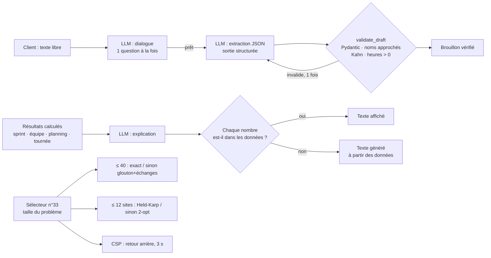
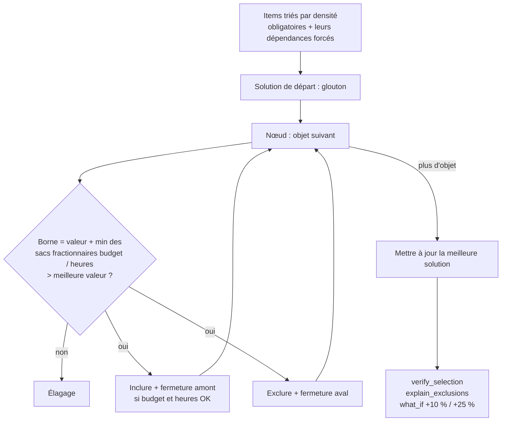
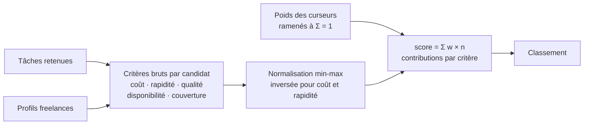
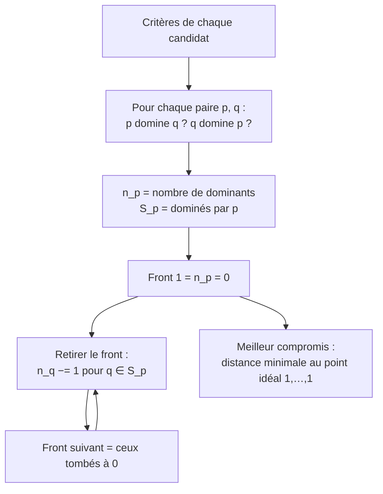
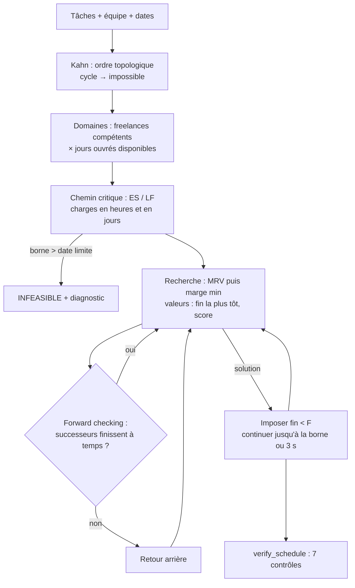
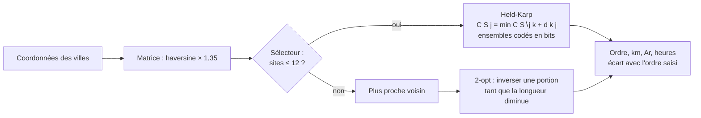

# 04 — Les algorithmes dans l'application

Pour chaque algorithme de la liste du cours utilisé par SmartBricks : l'idée générale, les données reçues (avec un **exemple JSON réel**, tiré de l'API sur le projet de démonstration « Boutique Soa »), ce qu'il décide, pourquoi lui, sa complexité, un exemple à la main, un schéma, et les fichiers où il est codé.

Tous les algorithmes sont des **fonctions pures** dans `backend/app/algorithms/` (aucune dépendance à FastAPI, à la base ni au LLM), testées par pytest, et chaque résultat est **revérifié par une fonction indépendante** avant d'être renvoyé.

| N° | Algorithme | Module | Fichier |
|---|---|---|---|
| 33 | Métaheuristique & IA : copilote LLM + sélecteur de méthode | A | `llm/`, `services/copilot.py`, `algorithms/solver_selector.py`, `algorithms/dependencies.py` |
| 29 | Sac à dos multidimensionnel | B | `algorithms/knapsack_md.py` |
| 22 | Agrégation pondérée | C | `algorithms/matching.py` |
| 21 | Optimisation de Pareto | C | `algorithms/matching.py` |
| 3 | Satisfaction de contraintes (CSP) | D | `algorithms/csp_scheduler.py`, `algorithms/calendar.py` |
| 30 | Voyageur de commerce | E | `algorithms/tsp.py`, `algorithms/geo.py` |
| 11 | Min-Conflict | D (niveau B) | **non codé** (voir § 7) |

---

## 1. Copilote LLM et sélecteur de méthode (n°33)

### 1.1 Idée générale

Le n°33 de la liste du cours regroupe les **métaheuristiques et l'IA**. SmartBricks l'utilise sous deux formes complémentaires :

- **Le copilote** : un grand modèle de langage (LLM) joue le rôle d'un chef de produit. Il comprend un besoin exprimé en langage courant, pose des questions, le structure en JSON, puis explique les résultats. Il est bon pour **comprendre et reformuler**, mauvais pour **calculer** : on ne lui confie donc aucun chiffre.
- **Le sélecteur de méthode** (hyper-heuristique) : une règle de niveau supérieur qui choisit *quel* algorithme appliquer à chaque problème, selon sa taille. Une heuristique cherche une solution ; une hyper-heuristique choisit la méthode de recherche.

Types de problèmes où on l'utilise : extraction d'information à partir de texte, assistants conversationnels, génération d'explications ; et, pour le sélecteur, tout système qui doit garantir un temps de réponse borné sur des entrées de taille variable.

### 1.2 Données reçues dans SmartBricks

**Copilote, dialogue** (`POST /assistant/chat`) : l'historique des messages, transmis comme *données* (jamais comme consigne système) :

```json
[{"role": "user", "content": "Boutique Soa veut un site e-commerce avec paiement MVola, une application mobile de suivi des commandes, et l'installation du réseau dans ses agences de Tana, Antsirabe, Toamasina et Fianarantsoa. Budget 6 000 000 Ar, livraison dans 8 semaines."},
 {"role": "assistant", "content": "Merci, c'est très clair ! Une question avant de préparer votre projet : faut-il prévoir la livraison à domicile pour vos clients (choix de la livraison et suivi du livreur) ?"},
 {"role": "user", "content": "Oui"}]
```

**Copilote, extraction** : la même conversation entre balises `<conversation>`, le schéma JSON `DRAFT_JSON_SCHEMA`, la date du jour, et les listes des compétences et des villes connues. Il renvoie le brouillon (extrait réel, projet n°2 créé pendant les tests) :

```json
{"project": {"title": "Boutique Soa — e-commerce, application mobile et réseau des agences",
             "budget_mga": 6000000, "budget_hours": 200, "deadline": "2027-01-08", "base_city": "Antananarivo"},
 "features": [{"ref": "F1", "title": "Catalogue produits", "req_type": "FUNCTIONAL", "business_value": 90,
               "estimated_hours": 56, "is_mandatory": true, "depends_on": []},
              {"ref": "F2", "title": "Panier et commande", "business_value": 85, "estimated_hours": 28,
               "is_mandatory": false, "depends_on": ["F1"]}],
 "tasks": [{"ref": "T2", "feature_ref": "F1", "title": "API des produits", "required_skill": "Node.js",
            "min_level": 3, "estimated_hours": 16, "depends_on": ["T3"], "on_site_city": null}],
 "sites": ["Antananarivo", "Antsirabe", "Toamasina", "Fianarantsoa"]}
```

**Copilote, explication** (`POST /projects/{id}/explain`) : uniquement les résultats déjà calculés, sous la forme `{"projet": {...}, "sprint": {...}, "equipe": [...], "planning": {...}, "tournee": {...}}` (fonction `build_facts` dans `services/explaining.py`).

**Sélecteur** : un seul nombre, la taille du problème (nombre de fonctionnalités, de sites, de tâches).

### 1.3 Ce qu'il décide et renvoie

- Dialogue : une réponse, ou le marqueur `[BROUILLON_PRET]` quand il a le budget, la date limite, la ville et les fonctionnalités clés.
- Extraction : le brouillon JSON. Il est ensuite **contrôlé sans IA** (`validate_draft`) : schéma Pydantic, compétences et villes reconnues par correspondance approchée, dépendances inconnues retirées, **cycles cassés** par le tri topologique de Kahn, heures > 0. Si le JSON est invalide, **une seule** nouvelle tentative avec l'erreur.
- Explication : un texte en français. Chaque nombre du texte est comparé aux données ; au moindre nombre étranger, le texte est remplacé par une explication générée automatiquement.
- Sélecteur : `MethodChoice(method, exact, reason, course_number)` ; la raison est affichée à l'utilisateur. Règles : sac à dos exact si ≤ 40 fonctionnalités ; Held-Karp si ≤ 12 sites ; CSP exact avec une limite de 3 s.

### 1.4 Pourquoi lui plutôt qu'une autre méthode

- Sans LLM, il faudrait un formulaire technique (fonctionnalités, compétences, niveaux) que le client non technique ne sait pas remplir : c'est le problème de départ. Les alternatives (analyse de texte par mots-clés) ne savent pas découper un besoin en tâches dépendantes.
- Mais un LLM n'est ni exact ni reproductible : c'est pourquoi **tout ce qui est chiffré est calculé par des algorithmes prouvés**, et tout ce qu'il produit est contrôlé (schéma, cycles, chiffres cités).
- Le sélecteur garantit l'objectif « chaque calcul en moins de 3 s » : les méthodes exactes sont exponentielles, donc un seuil fixe sur la taille borne le temps.

### 1.5 Complexité

- Contrôles après extraction : tri de Kahn en O(V + E) ; correspondance approchée en O(n × m) sur des listes de quelques dizaines de noms.
- Sélecteur : O(1) ; seul compte le coût de la méthode choisie.
- Coût monétaire du LLM : suivi par appel (tokens × prix), plafonné par `LLM_BUDGET_USD`.

### 1.6 Exemple à la main : casser un cycle

Tâches déclarées dans l'ordre T1, T2, T3 avec : T1 dépend de T3, T2 dépend de T1, T3 dépend de T2.

1. Kahn : degrés entrants T1 = 1, T2 = 1, T3 = 1 ; aucune tâche à degré 0 → tout le monde est dans un cycle.
2. On suit un cycle : T1 → T3 → T2 → T1.
3. Arête « la moins justifiée » : celle qui remonte le plus loin dans l'ordre de déclaration. « T1 dépend de T3 » va de la position 1 à la position 3 (recul de 2) ; les autres avancent. On la retire.
4. Nouveau Kahn : T1 (0), T2 (1), T3 (1) → ordre T1, T2, T3. Plus de cycle. L'avertissement affiché : « Dépendance circulaire détectée : la dépendance « T1 dépend de T3 » a été retirée (T3 est déclarée après T1). »

### 1.7 Schéma



### 1.8 Fichiers et fonctions

- `backend/app/llm/base.py` : interface `LLMProvider.chat()` / `.extract()`, `TokenUsage`.
- `backend/app/llm/mock.py` (`MockProvider`, `template_explanation`), `claude.py` (`ClaudeProvider`, sorties structurées), `gemini.py`, `prompts.py` (consignes), `draft.py` (`Draft`, `DRAFT_JSON_SCHEMA`).
- `backend/app/services/copilot.py` : `converse`, `extract_draft`, `validate_draft`, `match_name`, `explain`, `unknown_numbers`.
- `backend/app/algorithms/dependencies.py` : `topological_order`, `find_cycle`, `break_cycles`.
- `backend/app/algorithms/solver_selector.py` : `choose_knapsack_method`, `choose_tsp_method`, `choose_csp_method`, `solve_knapsack`, `solve_tour`, `solve_schedule_auto`.
- `backend/app/services/llm_usage.py` : `get_provider` (bascule en mock), `record_usage`, `usage_summary`.

---

## 2. Sac à dos multidimensionnel (n°29)

### 2.1 Idée générale

On a des objets, chacun avec une **valeur** et un **poids** dans plusieurs dimensions, et une capacité par dimension. On cherche l'ensemble d'objets de valeur maximale qui respecte toutes les capacités. Problèmes typiques : choix d'investissements sous budget, chargement d'un véhicule (poids et volume), choix de fonctionnalités à livrer. Le problème est NP-difficile ; on le résout exactement par **séparation et évaluation** (branch and bound) quand la taille le permet.

### 2.2 Données reçues

Les fonctionnalités du projet converties en `Item` (`services/scoping.py : to_items`). Extrait réel de `GET /projects/1/scope` :

```json
[{"ref": "F1", "title": "Catalogue produits", "business_value": 90, "estimated_hours": 56, "estimated_cost_mga": 2298000, "is_mandatory": true, "depends_on": []},
 {"ref": "F2", "title": "Panier et commande", "business_value": 85, "estimated_hours": 28, "estimated_cost_mga": 1095000, "is_mandatory": false, "depends_on": ["F1"]},
 {"ref": "F3", "title": "Paiement MVola", "business_value": 80, "estimated_hours": 24, "estimated_cost_mga": 923000, "is_mandatory": false, "depends_on": ["F2"]},
 {"ref": "F4", "title": "Comptes clients sécurisés", "business_value": 70, "estimated_hours": 20, "estimated_cost_mga": 782000, "is_mandatory": true, "depends_on": []},
 {"ref": "F11", "title": "Réseau des quatre agences", "business_value": 75, "estimated_hours": 32, "estimated_cost_mga": 1366000, "is_mandatory": true, "depends_on": []}]
```

et les deux capacités : `budget_mga = 6000000`, `budget_hours = 200`. Les 14 fonctionnalités coûtent 15 164 000 Ar et 374 h au total.

### 2.3 Ce qu'il décide et renvoie

```json
{"feasible": true, "optimal": true, "nodes": 18, "elapsed_ms": 0.2,
 "total_value": 320, "total_cost_mga": 5541000, "total_hours": 136,
 "budget_usage": 0.9235, "hours_usage": 0.68,
 "what_if": [{"increase_pct": 10, "extra_budget_mga": 600000, "added": ["F3"], "value_gain": 80,
              "message": "Avec 600 000 Ar de plus (+10 %), vous ajoutez : Paiement MVola. Valeur métier : +80."}]}
```

Retenues : F1, F2, F4, F11. Pour chaque écartée, une raison chiffrée (`explain_exclusions`), par exemple F3 : « Ne tient pas dans le budget restant : il faudrait 464 000 Ar de plus. » Si les obligatoires dépassent déjà les moyens, `feasible: false` avec `missing_cost_mga`. `verify_selection` recompte budget, heures, obligatoires et dépendances sans réutiliser le solveur.

### 2.4 Pourquoi lui

- Le problème est exactement un sac à dos : valeur à maximiser, deux capacités (Ar et heures), objets indivisibles. Les contraintes « obligatoire » et « dépendance » s'y ajoutent naturellement (fermetures amont et aval).
- La méthode exacte garantit « le périmètre proposé est le meilleur possible », argument fort pour un client. Le glouton, 10 fois plus rapide, est gardé comme repli (> 40 fonctionnalités) et comme comparaison : sur Boutique Soa il perd 1,4 % de valeur (345 contre 350 avec les taux de l'équipe).
- Une programmation dynamique classique serait pseudo-polynomiale en O(n × budget × heures) : avec un budget en Ariary de l'ordre de 10⁶, c'est impraticable.

### 2.5 Complexité

Pire cas O(2ⁿ) nœuds, chacun en O(n) pour la borne. En pratique l'élagage par la borne fractionnaire (minimum des bornes des deux dimensions) réduit l'arbre à quelques dizaines ou milliers de nœuds : 18 nœuds pour 14 fonctionnalités ; au pire 2 106 nœuds et 9,3 ms sur les instances aléatoires à 40 fonctionnalités du benchmark.

### 2.6 Exemple à la main

Budget 100 000 Ar et 10 h. A (obligatoire) : valeur 50, 40 000 Ar, 4 h. B (dépend de A) : 40, 30 000, 3 h. C (dépend de B) : 45, 40 000, 2 h. D : 30, 20 000, 5 h.

1. A est pris d'office : reste 60 000 Ar et 6 h, valeur 50.
2. Densités `v / (c/100 000 + h/10)` : C = 75, B = 66,7, D = 42,9 → ordre C, B, D.
3. Glouton de départ : C entraîne B (70 000 > 60 000, impossible) ; B tient (reste 30 000 Ar, 3 h) ; D demande 5 h, non. Meilleure valeur connue : **90**.
4. Borne à la racine : dimension budget seule (60 000 Ar, fractionnaire par v/c) : D 30 + B 40 + ¼ de C 11,25 = 81,25 ; dimension heures seule (6 h) : C 45 + B 40 + ⅕ de D 6 = 91. Minimum 81,25 → borne 50 + 81,25 = 131 > 90, on explore.
5. Branche « prendre C » : impossible (70 000 Ar). Branche « exclure C » : borne 50 + min(70, 58) = 108 > 90 → on explore ; « prendre B » donne 90 ; « exclure B » : borne 50 + 30 = 80 ≤ 90 → **élagué**.
6. Optimum prouvé : **A + B, valeur 90**. Et si +10 % : 70 000 Ar restants, B + C tiennent (70 000 Ar, 5 h) → A + B + C = 135, « vous ajoutez : Paiement ».

### 2.7 Schéma



### 2.8 Fichiers et fonctions

`backend/app/algorithms/knapsack_md.py` : `Item`, `_Problem` (fermetures, densité), `branch_and_bound`, `greedy`, `greedy_with_swaps`, `brute_force` (tests), `verify_selection`, `explain_exclusions`, `what_if`. Service : `backend/app/services/scoping.py` (`run_scope`, `stored_scope`). Tests : `backend/tests/algorithms/test_knapsack_md.py`.

---

## 3. Agrégation pondérée (n°22)

### 3.1 Idée générale

Quand on doit classer des options selon plusieurs critères exprimés dans des unités différentes (Ariary, jours, note sur 5), on **normalise** chaque critère sur [0, 1] (1 = le meilleur), puis on calcule un score unique `score = Σ wₖ × nₖ` avec des poids qui somment à 1. C'est la méthode de base de l'aide multicritère à la décision (choix de fournisseur, d'emplacement, de candidat).

### 3.2 Données reçues

Les tâches retenues (`TaskNeed`) et les candidats (`Candidate`, construits depuis les profils, `services/project_data.py : to_candidate`). Extraits réels :

```json
"tasks": [{"id": 2, "skill": "Node.js", "min_level": 3, "hours": 16}, {"id": 4, "skill": "React", "min_level": 3, "hours": 20},
          {"id": 22, "skill": "Réseau", "min_level": 3, "hours": 8}]
```

```json
{"id": 9, "name": "Hasina Rakotondrabe", "city": "Antananarivo", "hourly_rate_mga": 37000, "rating": 5.0,
 "on_time_rate": 0.63, "hours_per_day": 6, "skills": {"React": 4, "Node.js": 3}, "unavailability": []}
```

Plus les poids (`{"cost": 0.2, "speed": 0.2, "quality": 0.2, "availability": 0.2, "coverage": 0.2}` pour « Équilibré ») et le nombre de jours ouvrés jusqu'à la date limite (40).

### 3.3 Ce qu'il décide et renvoie

Pour chaque candidat capable d'au moins une tâche : les 5 critères bruts, les valeurs normalisées, la **contribution** de chaque critère (wₖ × nₖ, ce qui fait les barres de l'écran) et le score. Extrait réel du premier classé :

```json
{"rank": 1, "name": "Hanitra Rakotomanga", "hourly_rate_mga": 26000, "skills": {"Flutter": 3, "React": 3},
 "criteria": {"cost": 1040000, "speed": 5.714, "quality": 4.324, "availability": 40, "coverage": 0.294},
 "normalized": {"cost": 0.794, "speed": 0.77, "quality": 0.764, "availability": 1.0, "coverage": 0.381},
 "contributions": {"cost": 0.1588, "speed": 0.154, "quality": 0.1528, "availability": 0.2, "coverage": 0.0762},
 "score": 0.7418}
```

### 3.4 Pourquoi lui

Il est **transparent** : le client voit pourquoi un freelance est premier (barre de contributions) et peut changer ses priorités en direct ; le classement obéit immédiatement (test : 100 % coût ⇒ tri par coût croissant). Les méthodes plus élaborées (AHP, ELECTRE) demandent des comparaisons par paires que le client ne ferait pas. Sa faiblesse, dépendre de poids subjectifs, est compensée par Pareto (§ 4).

### 3.5 Complexité

O(N × T) pour les critères (N candidats, T tâches), O(N × K) pour les scores avec K = 5 critères, O(N log N) pour le tri. Instantané pour 25 freelances.

### 3.6 Exemple à la main

60 h de React, 20 jours ouvrés. Rivo : 40 000 Ar/h, 8 h/j, 20 j dispo, note 4,0, 90 % à l'heure. Fara : 20 000, 5 h/j, 12 j, 3,5, 60 %. Mialy : 30 000, 6 h/j, 20 j, 5,0, 100 %.

| | Coût = taux × 60 | Rapidité = 60 / (h/j × dispo/20) | Qualité = note × (0,5 + 0,5 × à l'heure) |
|---|---|---|---|
| Rivo | 2 400 000 | 60 / 8 = 7,5 j | 3,8 |
| Fara | 1 200 000 | 60 / (5 × 0,6) = 20 j | 2,8 |
| Mialy | 1 800 000 | 60 / 6 = 10 j | 5,0 |

Normalisation (coût et rapidité inversés) : Rivo (0 ; 1 ; 0,45), Fara (1 ; 0 ; 0), Mialy (0,5 ; 0,8 ; 1).
Poids « économique » (0,6 ; 0,2 ; 0,2) : Mialy 0,66, **Fara 0,60**, Rivo 0,29. Poids « rapide » (0,2 ; 0,6 ; 0,2) : Mialy 0,78, **Rivo 0,69**, Fara 0,20. Le classement change avec les priorités.

### 3.7 Schéma



### 3.8 Fichiers et fonctions

`backend/app/algorithms/matching.py` : `TaskNeed`, `Candidate`, `Criteria`, `compute_criteria`, `evaluate`, `normalize`, `normalize_weights`, `weighted_ranking`, `PRESETS`. Service : `backend/app/services/matching_service.py` (`compute_matching`, `resolve_weights`). Tests : `backend/tests/algorithms/test_matching.py`.

---

## 4. Optimisation de Pareto (n°21)

### 4.1 Idée générale

Quand plusieurs objectifs s'opposent, il n'y a pas une solution « meilleure » mais un ensemble de **compromis non dominés** : A domine B s'il est au moins aussi bon partout et strictement meilleur quelque part. Le **front de Pareto** est l'ensemble des solutions que personne ne domine. Le tri non dominé (NSGA-II) range les solutions en fronts 1, 2, 3… Utilisé en conception (coût / performance), en finance (risque / rendement), en ordonnancement multi-objectif.

### 4.2 Données reçues

Les mêmes `Criteria` qu'en § 3, et les critères choisis par le client pour le front (par défaut coût, rapidité, qualité ; au moins 2).

### 4.3 Ce qu'il décide et renvoie

Les fronts (listes d'identifiants) et le **meilleur compromis** : le point du front 1 le plus proche du point idéal (1, …, 1) dans l'espace normalisé. Extrait réel (critères par défaut, 23 candidats) :

```json
"fronts": [[7, 8, 11, 12, 14, 22, 23, 24, 25], [20, 6, 4, 18, 19, 16], [2, 5, 3, 15, 9], [21, 13], [1]],
"best_compromise": 11
```

Front 1 : 9 freelances (dont Toky Ramanantsoa, id 11, meilleur compromis). Rivo (id 1) est seul au front 5 : il sait faire beaucoup de tâches, donc son coût total est le plus élevé, et sa note est basse.

### 4.4 Pourquoi lui

Il ne dépend d'**aucun poids** : il élimine objectivement les choix dominés (Hasina au front 3 est battu sur tous les critères par quelqu'un) et montre au client la nature du compromis. Associé à l'agrégation pondérée, il évite qu'un mauvais réglage des curseurs cache un bon candidat.

### 4.5 Complexité

Tri non dominé en O(K × N²) : chaque paire est comparée une fois sur K critères (K = 3 à 5, N = 23 : quelques centaines de comparaisons). Meilleur compromis en O(|front| × K).

### 4.6 Exemple à la main

Avec les 3 freelances du § 3.6 et Hasina (coût 2 700 000, rapidité 13,3 j, qualité 3,24) sur (coût, rapidité, qualité) :
- Rivo domine Hasina (moins cher, plus rapide, mieux noté).
- Rivo, Fara, Mialy ne se dominent pas : Fara est la moins chère, Rivo le plus rapide, Mialy la mieux notée.
- Front 1 = {Rivo, Fara, Mialy}, front 2 = {Hasina}.
- Distance au point idéal (normalisé) : Rivo √(1 + 0 + 0,30) = 1,14, Fara √(0 + 1 + 1) = 1,41, Mialy √(0,25 + 0,04 + 0) = 0,54 → **Mialy** est le meilleur compromis.

### 4.7 Schéma



### 4.8 Fichiers et fonctions

`backend/app/algorithms/matching.py` : `dominates`, `non_dominated_sort`, `best_compromise`, et `suggest_team` (équipe suggérée gloutonne, couverture puis charge). Interface : `frontend/src/components/team/ParetoChart.tsx`. Tests : propriétés des fronts sur 150 instances dans `test_matching.py`.

---

## 5. Satisfaction de contraintes, CSP (n°3)

### 5.1 Idée générale

Un CSP est un ensemble de **variables**, chacune avec un **domaine** de valeurs possibles, et des **contraintes** entre variables. On cherche une affectation qui satisfait toutes les contraintes, par **retour arrière** (backtracking) aidé de la **propagation** (élaguer les domaines avant et pendant la recherche) et d'heuristiques de choix (MRV : la variable au plus petit domaine d'abord). Emplois du temps, affectation de ressources, sudoku, configuration de produits.

### 5.2 Données reçues

Les tâches retenues avec leurs dépendances (`SchedTask`), l'équipe avec compétences, heures par jour et indisponibilités (`SchedFreelancer`), le début du projet et la date limite. Extraits réels :

```json
"tasks": [{"id": 3, "title": "T3 Base de données des produits", "skill": "PostgreSQL", "min_level": 3, "hours": 8, "depends_on": []},
          {"id": 2, "title": "T2 API des produits", "skill": "Node.js", "min_level": 3, "hours": 16, "depends_on": [3]},
          {"id": 4, "title": "T4 Pages du catalogue", "skill": "React", "min_level": 3, "hours": 20, "depends_on": [1, 2]}],
"team": [{"id": 9, "name": "Hasina Rakotondrabe", "hours_per_day": 6, "skills": {"React": 4, "Node.js": 3}, "unavailable": []},
         {"id": 25, "name": "Soloniaina Razanakoto", "hours_per_day": 6, "skills": {"Réseau": 4, "DevOps": 3}}],
"start": "2026-11-16", "deadline": "2027-01-08"
```

### 5.3 Ce qu'il décide et renvoie

Pour chaque tâche, `(freelance, début, fin, jours)` ; la durée totale ; la borne du chemin critique ; l'optimalité ; les nœuds explorés. Extrait réel :

```json
{"status": "OK", "working_days_available": 40, "makespan_days": 18, "end_date": "2026-12-09", "lower_bound_days": 11,
 "critical_path": ["T3", "T2", "T4", "T6"], "optimal": true, "nodes": 24399, "elapsed_ms": 368.5,
 "assignments": [{"ref": "T3", "freelancer": "Fanja Rasolofo", "start": "2026-11-16", "end": "2026-11-17", "days": 2},
                 {"ref": "T2", "freelancer": "Hasina Rakotondrabe", "start": "2026-11-18", "end": "2026-11-20", "days": 3, "depends_on": ["T3"]}],
 "verification": {"constraints_passed": true, "checks": [{"name": "Dépendances", "passed": true}, {"name": "Date limite", "passed": true}]}}
```

En cas d'impossibilité, un diagnostic chiffré. Deux exemples réels :
- date limite à 5 jours ouvrés : « Le chemin critique (T3 → T2 → T4 → T6) demande 11 jours ouvrés, la date limite en laisse 5 : repoussez la date de 6 jours ouvrés ou réduisez le périmètre. »
- scénario à 3 semaines (15 j) : « Charge de Hasina Rakotondrabe : les 6 tâches que cette personne est seule à pouvoir faire (84 h à 6 h par jour) demandent 16 jours ouvrés, pour 15 jours ouvrés disponibles… », détecté avec **0 nœud exploré**.

### 5.4 Pourquoi lui

- Les règles du planning sont des contraintes dures hétérogènes (ordre, compétence, congés, non-chevauchement, date limite) : le CSP les exprime toutes sans les déformer, là qu'une programmation linéaire demanderait des variables binaires par (tâche, freelance, jour).
- La propagation par le **chemin critique** donne un diagnostic immédiat et une **borne inférieure** qui permet de prouver l'optimalité : sur Boutique Soa, la première solution est trouvée en 13 nœuds et 2 ms ; les 24 386 nœuds suivants servent à prouver qu'il n'existe pas de planning plus court.
- Les métaheuristiques (recuit, Min-Conflict) ne prouvent rien ; elles sont réservées au niveau B pour *réparer* un planning après un retard.

### 5.5 Complexité

Pire cas exponentiel (ordonnancement avec ressources, NP-difficile). Chaque nœud coûte O(tâches prêtes × freelances × jours). Limite de 3 s : on renvoie alors la meilleure solution trouvée avec `optimal: false`.

### 5.6 Exemple à la main

Une semaine (jours 0 à 4). M Maquettes (UI/UX, 8 h), A API (Node.js, 16 h), F Front (React, 16 h, après M et A), T Tests (React, 8 h, après F). Fara (UI/UX 5, React 3, 8 h/j), Tiana (Node.js 5, React 4, 8 h/j, absente le mercredi = jour 2).

1. Durées : M 1 j, A 2 j, F 2 j, T 1 j.
2. Chemin critique : A → F → T = 5 jours ; 5 disponibles : faisable sans marge. Dates au plus tard : T ≤ 4, F ≤ 3, A ≤ 1, M ≤ 1.
3. MRV : A n'a qu'une valeur (Tiana, lundi-mardi) → placée. M = Fara lundi. F : Fara mercredi-jeudi (fin jour 3 ✓) ; Tiana absente mercredi finirait vendredi (jour 4 > 3) ✗. T = Fara vendredi.
4. Durée 5 = borne → optimal, en 5 nœuds. Avec une date limite au jeudi : « Le chemin critique (API → Front → Tests) demande 5 jours ouvrés, la date limite en laisse 4 », sans aucune recherche.

### 5.7 Schéma



### 5.8 Fichiers et fonctions

`backend/app/algorithms/csp_scheduler.py` : `SchedTask`, `SchedFreelancer`, `Assignment`, `solve_schedule` (avec `values`, `forward_check`, `search` internes), `verify_schedule`. `backend/app/algorithms/calendar.py` : `working_days`, `available_days`, `add_working_days`. Service : `backend/app/services/scheduling.py` (`solve_constraints`, `latest_schedule`). Tests : `test_csp_scheduler.py`, `test_calendar.py`.

---

## 6. Voyageur de commerce (n°30)

### 6.1 Idée générale

Visiter n villes une fois chacune en minimisant la distance totale. NP-difficile ; exact par **Held-Karp** (programmation dynamique sur les sous-ensembles, O(n² 2ⁿ)) jusqu'à une douzaine de villes, approché par le **plus proche voisin** puis **2-opt** au-delà. Tournées de livraison, de maintenance, perçage de circuits imprimés.

### 6.2 Données reçues

La matrice des distances routières estimées entre le départ et les sites (`geo.distance_matrix` : haversine × 1,35). Villes réelles :

```json
[{"name": "Antananarivo", "latitude": -18.8792, "longitude": 47.5079}, {"name": "Toamasina", "latitude": -18.1443, "longitude": 49.3958},
 {"name": "Antsirabe", "latitude": -19.8659, "longitude": 47.0333}, {"name": "Fianarantsoa", "latitude": -21.4527, "longitude": 47.0857}]
```

Matrice (km) : Tana–Antsirabe 163, Tana–Toamasina 290, Tana–Fianarantsoa 391, Antsirabe–Toamasina 423, Antsirabe–Fianarantsoa 238, Toamasina–Fianarantsoa 594.

### 6.3 Ce qu'il décide et renvoie

L'ordre des visites, la distance, le coût (km × Ar/km), la durée (km / 40), la méthode, et l'écart avec l'ordre saisi. Extrait réel (départ Antsirabe, technicien Hery) :

```json
{"start": {"name": "Antsirabe", "reason": "ville de Hery Randriamampionona"}, "closed": true,
 "order": [{"step": 1, "name": "Antsirabe"}, {"step": 2, "name": "Fianarantsoa"}, {"step": 3, "name": "Toamasina"}, {"step": 4, "name": "Antananarivo"}],
 "legs": [{"from": "Antsirabe", "to": "Fianarantsoa", "km": 238.3}, {"from": "Fianarantsoa", "to": "Toamasina", "km": 594.2},
          {"from": "Toamasina", "to": "Antananarivo", "km": 290.5}, {"from": "Antananarivo", "to": "Antsirabe", "km": 162.7}],
 "distance_km": 1285.6, "cost_mga": 1542777, "duration_h": 32.1,
 "method": {"method": "Held-Karp", "exact": true, "reason": "3 site(s) à visiter (≤ 12) : Held-Karp calcule la tournée la plus courte possible en quelques millisecondes."}}
```

Depuis Tana, l'ordre saisi (Tana → Antsirabe → Toamasina → Fianarantsoa → Tana) fait 1 571 km : la tournée optimale économise 285 km et 342 471 Ar.

### 6.4 Pourquoi lui

Held-Karp est **exact** et, jusqu'à 12 sites, prend quelques dizaines de millisecondes (15 ms pour les 12 villes de la base) : inutile d'approximer. Au-delà, le temps est multiplié par ≈ 2,5 par site ajouté (46 ms à 12 sites, 80 ms à 13 dans le benchmark), d'où le seuil. 2-opt est gardé car il retrouve l'optimum dans la plupart des cas (écart moyen 0,1 à 1,9 % sur les instances aléatoires) alors que le plus proche voisin seul s'en écarte de 5 à 18 %.

### 6.5 Complexité

Held-Karp : O(n² 2ⁿ) en temps, O(n 2ⁿ) en mémoire (pour 12 sites : ≈ 600 000 opérations, contre 11! ≈ 40 millions de permutations en force brute). Plus proche voisin : O(n²). 2-opt : O(n²) par passe, nombre de passes fini car la longueur décroît strictement.

### 6.6 Exemple à la main

Départ Tana (0), sites Antsirabe (1), Toamasina (2), Fianarantsoa (3), distances ci-dessus. C[S][j] = plus court chemin partant de 0, visitant exactement S, finissant en j.
- Une ville : C[{1}][1] = 163, C[{2}][2] = 290, C[{3}][3] = 391.
- Deux villes : C[{1,2}][2] = 163 + 423 = 586 ; C[{1,2}][1] = 713 ; C[{1,3}][3] = 401 ; C[{1,3}][1] = 629 ; C[{2,3}][3] = 884 ; C[{2,3}][2] = 985.
- Trois villes : finir en 1 : min(985 + 423, 884 + 238) = 1 122 ; en 2 : min(629 + 423, 401 + 594) = 995 ; en 3 : min(713 + 238, 586 + 594) = 951.
- Retour à Tana : 1 122 + 163 = 1 285 ; 995 + 290 = 1 285 ; 951 + 391 = 1 342. **Optimum : 1 285 km**, Tana → Toamasina → Fianarantsoa → Antsirabe → Tana (ou l'inverse).
- 2-opt sur l'ordre saisi (1 571 km) : inverser la portion Antsirabe…Fianarantsoa retire les deux traversées de l'île et donne 1 285 km : l'optimum.

### 6.7 Schéma



### 6.8 Fichiers et fonctions

`backend/app/algorithms/tsp.py` : `tour_length`, `held_karp`, `brute_force` (tests), `nearest_neighbor`, `two_opt`. `backend/app/algorithms/geo.py` : `haversine_km`, `road_distance_km`, `distance_matrix`, `travel_cost_mga`, `travel_hours`. Service : `backend/app/services/touring.py`. Interface : `TourMap.tsx` (Leaflet), `TourSchema.tsx` (SVG). Tests : `test_tsp.py`, `test_geo.py`.

---

## 7. Min-Conflict (n°11) — non codé

Prévu au **niveau B** (`POST /tasks/{id}/propagate-delay`), Min-Conflict n'existe pas dans le code : aucun fichier `min_conflicts.py`, aucune route. Le principe prévu : allonger la tâche en retard, repérer les tâches en conflit, puis réaffecter de façon répétée la variable en conflit vers la valeur qui crée le moins de conflits, en évitant de changer de freelance, pour réparer le planning en modifiant le moins de choses possible. Le sélecteur de méthode et l'écran benchmark le mentionnent comme méthode approchée « prévue au niveau B ».
