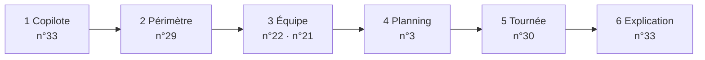

# 07 — Présentation orale (15 à 20 minutes)

Quinze diapositives, dans l'ordre imposé. Pour chacune : le titre, le contenu affiché (court), un schéma si utile, et le **script oral complet**. Durée indiquée entre crochets ; total ≈ 18 minutes, dont 4 de démonstration.

Tous les chiffres viennent de l'exécution réelle (projet de démonstration « Boutique Soa », données reproductibles) : `02_PLAN_DE_TEST.md` pour le parcours, `docs/benchmark_resultats.json` pour les mesures. Les temps dépendent de la machine ; les valeurs, coûts et distances non.

Le fichier `SmartBricks_presentation.pptx` (même dossier) reprend ces diapositives ; le script est dans les notes de l'orateur.

---

## Diapositive 1 — Couverture [0:30]

**Affiché**
- SmartBricks
- Du besoin flou au projet réaliste
- Copilote IA + algorithmes d'optimisation
- Nom, formation, date

**Script**
> Bonjour. Je vais vous présenter SmartBricks, une plateforme qui aide un client non technique à transformer une idée floue en un vrai projet informatique : un périmètre chiffré, une équipe de freelances, un planning qui tient, et une tournée pour les interventions sur site à Madagascar. Le principe, vous allez le voir, tient en une phrase : une IA pour dialoguer, des algorithmes pour décider.

---

## Diapositive 2 — Vision [0:45]

**Affiché**
- Oser rêver, réaliser son imagination
- La technologie au service de l'humain
- Un commerçant doit pouvoir lancer son projet numérique sans être informaticien

**Script**
> Notre point de départ est simple. Beaucoup de commerçants et d'associations à Madagascar ont des idées : vendre en ligne, suivre leurs commandes, relier leurs agences. Mais entre l'idée et le projet, il y a un mur : il faut savoir découper, chiffrer, recruter, planifier. SmartBricks veut abattre ce mur. Oser rêver, et faire en sorte que la technologie serve l'humain, pas l'inverse.

---

## Diapositive 3 — Le problème [1:00]

**Affiché**
- « Je veux un site avec paiement MVola, une appli, et le réseau dans mes 4 agences. 6 millions d'Ariary, 8 semaines. »
- 14 fonctionnalités rêvées = 15,2 M Ar pour 6 M de budget
- 25 freelances, 12 villes, des congés, des dépendances

**Script**
> Prenons Boutique Soa, notre cliente de démonstration. Elle dit : « Je veux un site e-commerce avec paiement MVola, une application mobile de suivi, et le réseau dans mes quatre agences. Six millions d'Ariary, huit semaines. » Une fois découpé, son rêve représente quatorze fonctionnalités, soit quinze virgule deux millions d'Ariary pour six de budget. En face, vingt-cinq freelances dans cinq villes, chacun avec ses compétences, son tarif, ses congés. Et quatre agences à visiter physiquement. Aucun humain ne peut faire tous ces arbitrages de tête de façon optimale. Et un modèle de langage seul non plus : il invente des chiffres.

---

## Diapositive 4 — Cinq questions, cinq problèmes [1:15]

**Affiché**

| Question du client | Problème | N° |
|---|---|---|
| Que veut-il vraiment ? | Extraction et dialogue | 33 |
| Que livrer d'abord ? | Sac à dos multidimensionnel | 29 |
| Avec qui ? | Agrégation pondérée + Pareto | 22, 21 |
| Quand ? | Satisfaction de contraintes | 3 |
| Dans quel ordre visiter les agences ? | Voyageur de commerce | 30 |

**Script**
> Le cœur du projet, c'est d'avoir reconnu que le besoin du client cache cinq questions, et que chacune est un problème classique du cours. « Que veut-il vraiment ? » : c'est de l'extraction d'information, confiée à une IA, numéro 33. « Que livrer d'abord avec mon budget ? » : c'est un sac à dos à deux dimensions, Ariary et heures, numéro 29. « Avec qui ? » : un choix multicritère, résolu par agrégation pondérée, numéro 22, et par optimisation de Pareto, numéro 21. « Quand ? » : un problème de satisfaction de contraintes, numéro 3. Et « dans quel ordre visiter les agences ? » : le voyageur de commerce, numéro 30. Chaque étape a donc un algorithme précis, que je peux justifier.

---

## Diapositive 5 — La solution : l'enchaînement [1:00]

**Affiché** (schéma en 6 étapes)

**Script**
> Voici l'enchaînement. Le client parle au copilote, qui pose des questions puis produit un brouillon structuré. Le client le corrige. Le sac à dos choisit le sprint 1. Le matching propose une équipe. Le CSP construit le planning. Le voyageur de commerce optimise la tournée. Et pour finir, le copilote explique le tout en français simple. Chaque étape consomme le résultat de la précédente. Et surtout, la règle d'or : l'IA ne calcule jamais un budget, un planning ou une tournée. Elle parle ; les algorithmes décident.

---

## Diapositive 6 — Copilote et sélecteur de méthode (n°33) [1:30]

**Affiché**
- Une question à la fois, puis un brouillon JSON validé
- Contrôles sans IA : compétences, villes, cycles (Kahn), heures > 0
- Explication vérifiée : tout nombre absent des données ⇒ texte remplacé
- Sélecteur : exact si ≤ 40 fonctionnalités, ≤ 12 sites ; CSP limité à 3 s
- Mode simulé : démonstration sans clé ni réseau

**Script**
> Premier algorithme, le numéro 33, sous deux formes. D'abord le copilote. Il pose une question à la fois, en français simple, jusqu'à connaître le budget, la date, la ville et les fonctionnalités clés. Puis il produit un JSON validé par un schéma. Mais on ne lui fait pas confiance : un programme vérifie que les compétences et les villes existent, accepte « Tamatave » pour Toamasina, et détecte les dépendances circulaires avec le tri topologique de Kahn. S'il y a un cycle, il retire la dépendance la moins justifiée et le signale. À la fin, quand le copilote explique le plan, chaque nombre de son texte est comparé aux résultats calculés. Un seul nombre inventé, et le texte est remplacé par une explication générée à partir des données.
> Deuxième forme, le sélecteur de méthode, une hyper-heuristique : il ne cherche pas une solution, il choisit la méthode. Jusqu'à quarante fonctionnalités, le sac à dos est exact ; jusqu'à douze sites, la tournée est exacte ; le planning dispose de trois secondes. Et il affiche toujours sa raison au client.
> Enfin, la démonstration tourne avec un fournisseur simulé : aucune clé, aucun réseau, résultats reproductibles. Claude ou Gemini se branchent par une variable d'environnement, avec un plafond de dépense de quatre dollars.

---

## Diapositive 7 — Le sac à dos multidimensionnel (n°29) [2:00]

**Affiché**
- max Σ valeur — sous Σ coût ≤ 6 000 000 Ar et Σ heures ≤ 200 h, obligatoires, dépendances
- Retenues : Catalogue, Panier, Comptes, Réseau ⇒ 5 541 000 Ar (92 %), 136 h (68 %)
- MVola écarté : il manque 464 000 Ar
- Et si +600 000 Ar ? ⇒ + Paiement MVola (valeur +80)
- Séparation et évaluation : 18 nœuds, optimum prouvé

(Tableau retenues / écartées, jauges budget et heures, encart « Et si ? ».)

**Script**
> Le sac à dos. On maximise la valeur métier, sous deux capacités à la fois : le budget en Ariary et les heures. On ajoute deux règles du monde réel : les fonctionnalités obligatoires, et les dépendances, car pas de paiement sans panier, ni de panier sans catalogue.
> Je le résous par séparation et évaluation. À chaque nœud, on inclut ou on exclut une fonctionnalité. Inclure, c'est aussi prendre ce dont elle dépend ; exclure, c'est aussi écarter ce qui dépend d'elle. On évalue chaque branche par une borne : le sac à dos fractionnaire sur le budget seul, et celui sur les heures seules. Chacun est une relaxation, donc une borne valide, et leur minimum aussi. Si la borne ne bat pas la meilleure solution connue, on coupe la branche.
> Exemple réel : les trois obligatoires, catalogue, comptes et réseau, coûtent 4 446 000 Ariary. Il reste 1 554 000. Le panier, à 1 095 000, entre. Il reste 459 000 ; le paiement MVola en demande 923 000 : il manque 464 000 Ariary, et c'est exactement ce que l'écran dit au client.
> Résultat : 5 541 000 Ariary, 92 % du budget, en 18 nœuds au lieu de 16 384 combinaisons. Et l'encart « et si ? » relance le calcul avec dix pour cent de plus : avec 600 000 Ariary de plus, vous ajoutez le paiement MVola. C'est une phrase qu'un client comprend et peut négocier.

---

## Diapositive 8 — Le matching (n°22 et n°21) [2:00]

**Affiché**
- Score = Σ poids × critère normalisé (coût, rapidité, qualité, disponibilité, couverture)
- Fronts de Pareto : personne ne fait mieux sur tous les critères à la fois
- Meilleur compromis = le plus proche du point idéal
- Exemple réel sur 4 des 23 candidats :

| | Coût | Rapidité | Qualité | Front |
|---|---|---|---|---|
| Rado | 188 000 Ar | 2,0 j | 3,57 | 1 |
| Nirina | 528 000 Ar | 2,0 j | 4,01 | 1 |
| Toky | 1 584 000 Ar | 4,8 j | 4,83 | 1 ★ compromis |
| Rivo | 4 324 000 Ar | 21,0 j | 2,70 | 5 |

(Nuage coût × durée, front relié, étoile sur le meilleur compromis.)

**Script**
> Pour l'équipe, cinq critères calculés pour ce projet : le coût des tâches que le freelance sait faire, le nombre de jours qu'il lui faudrait, sa qualité (note pondérée par sa ponctualité), sa disponibilité et sa couverture des tâches.
> Première méthode, l'agrégation pondérée, numéro 22. On normalise chaque critère entre zéro et un, en inversant ceux qu'on veut minimiser, puis on fait une somme pondérée. Le client règle les poids avec des curseurs. En « Économique », Rado est premier ; en « Rapide », c'est Nirina. L'écran montre la contribution de chaque critère, donc le client comprend pourquoi.
> Mais un score dépend des poids. D'où la deuxième méthode, Pareto, numéro 21. Un freelance en domine un autre s'il est au moins aussi bon partout, et strictement meilleur quelque part. Le premier front, ce sont ceux que personne ne domine. Regardez : Rado est le moins cher, Nirina aussi rapide mais mieux noté, Toky le mieux noté. Aucun ne domine les autres : ils sont tous les trois sur le front 1. Rivo, lui, coûte 4,3 millions pour 21 jours avec une note de 2,7 : il est dominé, au front 5. Le meilleur compromis, c'est le point du front le plus proche de l'idéal : ici Toky.
> Enfin, l'équipe suggérée prend, compétence par compétence, le meilleur score capable, puis vérifie que la charge tient avant la date limite. Pour Boutique Soa : quatre personnes.

---

## Diapositive 9 — Le planning par contraintes (n°3) [2:00]

**Affiché**
- Variables : (freelance, début) de chaque tâche — Domaines : compétents × jours ouvrés
- Contraintes : dépendances, compétences, congés, une tâche à la fois, date limite
- Propagation : chemin critique Base → API → Pages → Panier = 11 jours, borne inférieure
- Résultat : 18 jours ouvrés, fin le 9 décembre 2026, optimum prouvé, 7/7 contrôles
- Diagnostic à 3 semaines : « Hasina : 84 h à 6 h par jour = 16 jours pour 15 »

(Mini-planning de 4 tâches avec dépendances, chemin critique en couleur, encart diagnostic.)

**Script**
> Le planning est un problème de satisfaction de contraintes, numéro 3. Les variables : pour chaque tâche, qui la fait et quand elle commence. Les domaines : les freelances qui ont la compétence au bon niveau, et les jours ouvrés. Les contraintes : les dépendances, les compétences, les congés, une seule tâche à la fois par personne, et la date limite.
> Avant toute recherche, je propage. La méthode du chemin critique calcule, pour chaque tâche, sa date au plus tôt et au plus tard. Ici, le chemin base de données, API, pages du catalogue, pages du panier dure au minimum onze jours : c'est une borne inférieure. Aucun planning ne peut faire moins.
> Puis je cherche avec retour arrière. On choisit la tâche qui a le moins de créneaux possibles, c'est l'heuristique MRV ; on essaie d'abord la fin la plus tôt ; et après chaque choix, on vérifie en avant qu'aucune tâche restante n'est condamnée. Une fois une solution trouvée, on cherche strictement plus court.
> Résultat : 18 jours ouvrés, fin le 9 décembre. Pourquoi pas 11 ? Parce que Hasina est la seule à faire le React et le Node.js : sa charge impose 18 jours. Le solveur l'a prouvé en explorant 24 399 nœuds en un tiers de seconde. Et une fonction indépendante, `verify_schedule`, revérifie les sept contrôles : sept sur sept.
> Si on ramène la date limite à trois semaines, il n'y a même pas de recherche : « Hasina doit faire 84 heures à 6 heures par jour, cela fait 16 jours, il en reste 15 : repoussez d'un jour ou ajoutez un renfort. » Un diagnostic chiffré et actionnable, pas un simple « impossible ».

---

## Diapositive 10 — La tournée (n°30) puis l'explication [1:30]

**Affiché**
- 4 agences : Tana, Antsirabe, Toamasina, Fianarantsoa
- Held-Karp (exact) : Fianarantsoa → Toamasina → Tana → Antsirabe → retour
- 1 286 km — 1 542 777 Ar — 32,1 h ; −18 % par rapport à l'ordre saisi
- Distance = haversine × 1,35 ; 1 200 Ar/km ; 40 km/h
- Puis : le copilote explique, chaque chiffre vérifié

(Villes placées selon leurs coordonnées, itinéraire numéroté, distance et coût.)

**Script**
> Dernier problème, la tournée du technicien réseau, Soloniaina, qui part de Fianarantsoa. Les distances sont estimées par la formule de haversine, multipliée par un facteur routier de 1,35 ; c'est une approximation, et je l'assume.
> Avec quatre sites, j'utilise Held-Karp, une programmation dynamique sur les sous-ensembles. Pour chaque ensemble de villes visitées et chaque ville d'arrivée, on garde seulement le meilleur chemin : c'est le principe de Bellman. C'est exact, en n² fois 2 puissance n, quelques millisecondes ici.
> Résultat : Fianarantsoa, Toamasina, Tana, Antsirabe, puis retour. 1 286 kilomètres, 1 542 777 Ariary. L'ordre saisi par la cliente faisait 1 571 kilomètres : on économise 18 %.
> Au-delà de douze sites, le sélecteur passe au plus proche voisin amélioré par 2-opt, qui décroise les trajets.
> Et l'étape finale : le copilote reçoit uniquement ces résultats et les explique à la cliente. Si son texte contient un chiffre qui n'est pas dans les données, il est rejeté.

---

## Diapositive 11 — Architecture [1:00]

**Affiché**
- React 18 + TypeScript + Vite → API FastAPI asynchrone (/api/v1)
- Services → algorithmes purs (aucune dépendance au web, à la base, à l'IA)
- Copilote : simulé, Claude ou Gemini, suivi des coûts
- PostgreSQL 17 (Docker), SQLAlchemy asynchrone, Alembic, JWT + argon2

(Schéma en blocs.)

**Script**
> Côté technique, l'interface est en React et TypeScript. Elle appelle une API FastAPI asynchrone. Les routes sont minces : elles délèguent à des services, qui lisent la base et appellent les algorithmes. Les algorithmes sont des fonctions pures, sans base, sans web, sans IA : c'est ce qui les rend testables un par un. Le copilote est derrière une interface commune, avec trois fournisseurs interchangeables, et chaque appel payant est compté. Les données sont dans PostgreSQL, le schéma est versionné par Alembic, et l'authentification utilise JWT et argon2.

---

## Diapositive 12 — Démonstration [4:00]

**Affiché**
- 0:00 Connexion « Soa » — tableau de bord
- 0:30 Copilote : exemple Boutique Soa, une question, brouillon de 14 briques
- 1:15 Périmètre : jauges, raisons, « et si ? »
- 2:00 Équipe : préréglages, nuage de Pareto, équipe suggérée
- 2:45 Planning : Gantt, 7/7, puis « Scénario impossible »
- 3:30 Tournée sur la carte, puis synthèse expliquée

**Script (à dire pendant les manipulations)**
> **[0:00]** Je me connecte en un clic avec le compte de Soa. Le tableau de bord montre le projet et l'avancement en six briques.
> **[0:30]** Nouveau projet, j'utilise l'exemple Boutique Soa. Le copilote ne répond pas tout de suite par un plan : il pose une question, sur la livraison à domicile. Je réponds oui. À droite apparaît le brouillon : quatorze briques, trente tâches, quatre sites. Je peux corriger une valeur ou des heures avant de valider.
> **[1:15]** Périmètre. Les deux jauges : 92 % du budget, 68 % des heures. Chaque brique écartée a sa raison, par exemple MVola : « il faudrait 464 000 Ariary de plus ». En bas, l'encart « et si ? ».
> **[2:00]** Équipe. Je passe d'« Économique » à « Rapide » : le classement change sous vos yeux. Voici le nuage de Pareto, le front en bleu, l'étoile du meilleur compromis. Je clique sur « Équipe suggérée » : quatre personnes, charge absorbable.
> **[2:45]** Planning. Le Gantt, une ligne par freelance, le chemin critique entouré, et le panneau de vérification : sept contraintes sur sept. Je clique sur « Scénario impossible » : le diagnostic chiffré apparaît, et le vrai planning reste intact en dessous.
> **[3:30]** Tournée : la carte, l'itinéraire numéroté, 1 286 kilomètres, 18 % de moins que l'ordre saisi. Enfin la synthèse : le copilote explique le plan, avec la mention « chaque chiffre vérifié dans les données ».

*Plan B sans réseau : la démo ne dépend ni d'internet ni d'une clé ; la carte bascule d'elle-même sur le schéma hors ligne.*

---

## Diapositive 13 — Résultats mesurés [1:15]

**Affiché**
- 124 tests automatisés passent (≈ 20 s) ; parcours complet : 45/45 vérifications
- Sac à dos : = force brute sur 200 instances ; 40 fonctionnalités ≤ 10 ms ; glouton jusqu'à −13 %
- Planning : 1ʳᵉ solution en 13 nœuds (1,7 ms) ; optimum prouvé en 0,38 s
- Tournée : Held-Karp = force brute ; 12 villes en 14 ms ; plus proche voisin +18 %, 2-opt 0 %

**Script**
> Ce que j'ai mesuré, pas estimé. 124 tests automatisés passent en une vingtaine de secondes, et le parcours complet de l'API, 45 vérifications, passe intégralement.
> Le sac à dos donne exactement la même valeur que la force brute sur 200 instances aléatoires. À quarante fonctionnalités, il reste sous dix millisecondes. Le glouton, lui, perd en moyenne 5 % et jusqu'à 13 % de valeur. Sur Boutique Soa, avec les tarifs de l'équipe, il perd 1,4 %.
> Le planning : la première solution sort en 13 nœuds, moins de deux millisecondes, et c'est déjà la bonne. Prouver qu'on ne peut pas faire mieux prend environ 0,38 seconde.
> La tournée : Held-Karp donne la même longueur que la force brute ; sur les douze villes de la base, 4 320 kilomètres en 14 millisecondes. Le plus proche voisin fait 18 % de plus ; 2-opt rattrape l'optimum.
> Ces chiffres sont recalculés en direct par la page « Comparaison des méthodes ».

---

## Diapositive 14 — Limites et perspectives [1:00]

**Affiché**
- Synthèse : 6,76 M Ar, car la tournée (1,54 M) n'entre pas dans le sac à dos
- Distances estimées (×1,35) ; jours fériés ignorés
- Claude non testé avec une vraie clé ; Gemini non testé
- Niveau B à faire : Min-Conflict (n°11) après un retard, contrainte « sur site » liée à la tournée, espace freelance, export PDF

**Script**
> Je préfère vous montrer moi-même les limites. Un : le sac à dos respecte le budget des fonctionnalités, mais la tournée coûte 1,5 million en plus. La synthèse affiche donc 6,76 millions et le signale honnêtement. La correction serait de réserver les frais de tournée avant le sac à dos. Deux : les distances sont estimées, et les jours fériés ne sont pas gérés. Trois : l'intégration Claude est testée avec un client simulé, mais pas avec une vraie clé ; Gemini n'est pas testé.
> Pour la suite, le niveau B : réparer un planning après un retard avec Min-Conflict, numéro 11, en changeant le moins de choses possible ; relier les tâches sur site à l'ordre de la tournée ; et un espace pour les freelances.

---

## Diapositive 15 — Conclusion [0:45]

**Affiché**
- Une IA pour comprendre et expliquer
- Des algorithmes prouvés pour décider
- Des résultats vérifiés, expliqués, chiffrés
- Merci — questions ?

**Script**
> Pour conclure. SmartBricks montre qu'on peut combiner les deux mondes : l'IA pour comprendre un client et lui expliquer, les algorithmes pour décider de façon prouvable. Chaque résultat est vérifié par une fonction indépendante, et chaque refus est expliqué avec des chiffres. Boutique Soa sait maintenant ce qu'elle aura, avec qui, quand, et pour combien. Merci de votre attention ; je suis prêt pour vos questions.

---

## Dix questions probables du jury

**1. Pourquoi ne pas laisser l'IA tout faire ?**
Un modèle de langage n'est ni exact ni reproductible : il peut inventer un total ou ignorer une contrainte. Les algorithmes donnent un optimum prouvé ou un diagnostic vérifiable. L'IA est réservée à ce qu'elle fait bien : comprendre et reformuler. Et même là, on contrôle sa sortie : schéma, cycles, chiffres cités.

**2. Comment prouvez-vous que le sac à dos est optimal ?**
La borne (minimum des deux sacs fractionnaires) est une relaxation, donc on ne coupe jamais une branche qui contient mieux. Quand l'arbre est entièrement exploré, la meilleure solution est optimale. Le test le confirme : même valeur que la force brute sur 200 instances.

**3. Que se passe-t-il avec 100 fonctionnalités ?**
Le sélecteur passe au glouton avec échanges 1-1, en moins de 3 s ; la solution est marquée « approchée ». Mesuré à 40 fonctionnalités, ce glouton s'écarte de 2,6 % en moyenne de l'optimum.

**4. Pourquoi le planning fait 18 jours alors que le chemin critique en fait 11 ?**
Le chemin critique ignore les ressources. Hasina est la seule personne de l'équipe pour le React et le Node.js ; ses six tâches s'enchaînent. Le solveur a exploré tout l'arbre pour prouver qu'aucun planning de 17 jours n'existe avec cette équipe.

**5. Et si le CSP ne trouve rien en 3 secondes ?**
Il renvoie la meilleure solution trouvée, marquée non optimale, avec l'écart maximal à la borne. S'il n'en a trouvé aucune, le statut est « inconnu » et non « impossible », car on ne prétend pas avoir prouvé l'impossibilité. La réparation par Min-Conflict est prévue au niveau B.

**6. Comment choisissez-vous entre deux freelances du premier front ?**
Ils sont tous des compromis acceptables : c'est au client de choisir selon ses priorités, avec les curseurs. Pour l'aider, on indique le meilleur compromis, le plus proche du point idéal.

**7. Vos distances sont-elles fiables ?**
Ce sont des estimations : vol d'oiseau × 1,35, environ 162 km pour Tana–Antsirabe, contre environ 170 km réels. L'ordre de visite est peu sensible à ce facteur, puisqu'il multiplie toutes les distances. Une vraie matrice routière remplacerait une seule fonction.

**8. Combien coûte l'IA, et que se passe-t-il sans réseau ?**
Chaque appel est enregistré (tokens, coût) ; au-delà de 4 dollars, ou sans clé, ou sans prix renseignés, le système bascule automatiquement en mode simulé. La démonstration entière fonctionne sans réseau.

**9. Comment empêchez-vous l'injection de consignes par le client ?**
Le texte du client est toujours transmis comme donnée, entre balises, jamais comme consigne système. Et même si le modèle était détourné, sa sortie doit respecter le schéma JSON, puis les contrôles sans IA ; l'explication est rejetée si elle cite un chiffre inconnu.

**10. Qu'est-ce qui n'est pas fini ?**
Le niveau B : Min-Conflict après un retard, la contrainte « sur site » reliée à la tournée, les flèches de dépendance dans le Gantt, l'espace freelance et l'export PDF. Les frais de tournée ne sont pas réservés dans le budget du sac à dos. Claude n'a pas été testé avec une vraie clé, et Gemini pas du tout.
