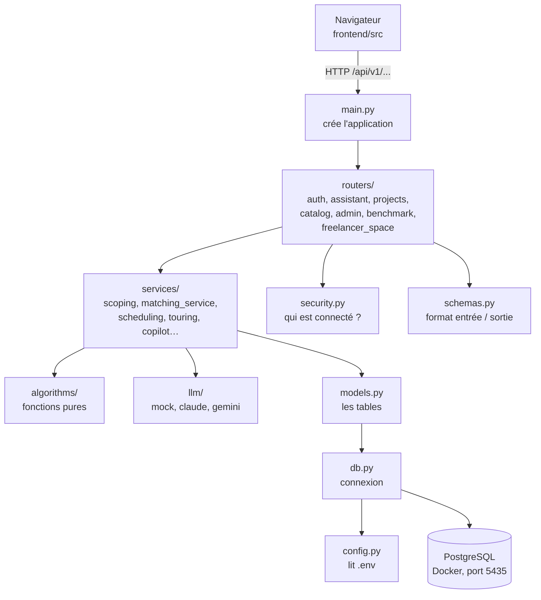
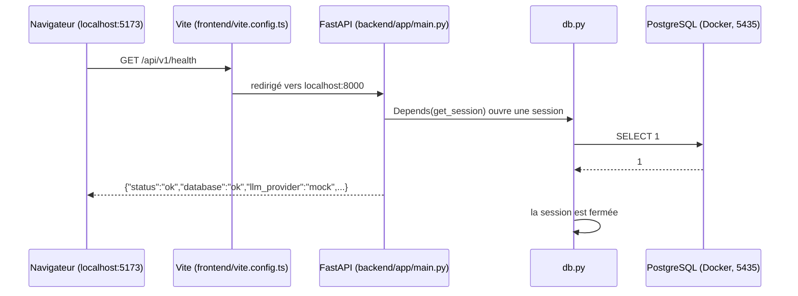

# Leçon 1 — Création du projet : l'arborescence et le rôle de chaque dossier

## 1. Objectif

À la fin de cette leçon, tu sauras :
- dire **où se trouve** chaque partie du projet et **pourquoi** elle est là ;
- expliquer la règle d'organisation du backend : **routeur → service → algorithme** ;
- suivre une requête du navigateur jusqu'à la base de données, en sachant quels dossiers elle traverse.

**Besoin du projet :** le cahier des charges impose une séparation stricte : *« le LLM ne calcule jamais un budget, un planning ou une tournée »* et *« les algorithmes sont des fonctions pures »* (CLAUDE.md, « Règles de travail »). L'arborescence est la traduction physique de ces règles : chaque responsabilité a son dossier, et on peut prouver au jury qu'un algorithme ne dépend ni du web, ni de la base, ni de l'IA.

---

## 2. Vue d'ensemble

Le projet contient **3 grands blocs** à la racine : `backend/` (le serveur Python), `frontend/` (l'interface React) et `docs/` (la documentation), plus **6 fichiers de configuration** (`docker-compose.yml`, `.env`, `.env.example`, `.gitignore`, `README.md`, `CLAUDE.md`).

```
smartbricks/
├── docker-compose.yml        la base PostgreSQL dans un conteneur
├── .env / .env.example       les réglages (secrets, fournisseur LLM…)
├── .gitignore                ce que git ne doit jamais enregistrer
├── CLAUDE.md                 la spécification complète du projet
├── README.md                 le lancement en 10 minutes et les résultats
├── backend/
│   ├── requirements.txt      les paquets Python
│   ├── pytest.ini            le réglage des tests
│   ├── alembic.ini           le réglage des migrations
│   ├── alembic/              les migrations (versions successives du schéma de la base)
│   ├── app/                  le code de l'API
│   │   ├── main.py  config.py  db.py  models.py  schemas.py  security.py
│   │   ├── seed.py  demo_data.py  errors.py
│   │   ├── routers/          la « porte d'entrée » HTTP
│   │   ├── services/         la « cuisine » : base ↔ algorithmes ↔ LLM
│   │   ├── algorithms/       les mathématiques pures
│   │   ├── llm/              le copilote : mock, Claude, Gemini
│   │   └── assets/fonts/     la police du PDF (niveau B)
│   └── tests/                les tests pytest (dont tests/algorithms/)
├── frontend/
│   ├── package.json  vite.config.ts  tsconfig*.json  index.html
│   └── src/
│       ├── main.tsx  App.tsx
│       ├── api/              les appels au backend
│       ├── auth/             la session de l'utilisateur
│       ├── pages/            un fichier par écran
│       ├── components/       les morceaux d'écran réutilisables
│       └── lib/              les petits utilitaires
└── docs/                     guides, présentation, et ce cours (docs/cours/)
```

### Le schéma qui résume tout : qui appelle qui dans le backend



**À retenir :** les flèches ne vont **que vers le bas**. Un algorithme n'importe jamais un routeur ; un routeur ne fait jamais de calcul. C'est ce qu'on appelle une **architecture en couches**.

> ⚠️ **Correction par rapport à ta consigne :** tu as écrit « port 5433 ». Dans ce projet, le port est **5435** ([docker-compose.yml:11](../../docker-compose.yml#L11)), parce que 5432, 5433 et 5434 sont déjà pris par d'autres projets sur ta machine (commentaire ligne 2). Un jury peut te piéger là-dessus : retiens 5435.

---

## 3. Chaque dossier, un par un

La leçon 1 ne contient pas de fonctions : j'applique donc la fiche **à chaque dossier**, des fondations vers le haut (ceux qui sont utilisés avant ceux qui les utilisent).

### 3.1 La racine du projet

- **Rôle :** regrouper ce qui concerne le projet *entier* (base de données, réglages, documentation), et pas seulement le backend ou le frontend.
- **Contenu :**
  - `docker-compose.yml` : décrit le conteneur PostgreSQL (leçon 3).
  - `.env.example` : le **modèle** des réglages, enregistré dans git. `.env` : la **copie réelle** avec tes secrets (clé Claude…), **jamais** enregistrée dans git.
  - `.gitignore` : la liste de ce que git ignore. Ligne 2 : `.env` (les secrets) ; lignes 5 à 9 : `__pycache__/`, `.venv/`, `.pytest_cache/` (fichiers régénérables) ; lignes 12 à 13 : `node_modules/`, `dist/` (paquets et version compilée du frontend).
  - `CLAUDE.md` : la spécification. `README.md` : le mode d'emploi.
- **Il est utilisé par :** Docker (`docker compose up -d` lit `docker-compose.yml`), `config.py` (lit `.env`), git (lit `.gitignore`).
- **Pourquoi `.env` hors de git :** si ta clé d'API Claude était publiée sur GitHub, n'importe qui pourrait la consommer à tes frais.

### 3.2 `backend/` — le serveur

- **Rôle :** tout ce qui tourne côté serveur en Python : l'API, les algorithmes, le copilote, les tests.
- **Fichiers de réglage à sa racine :**
  - `requirements.txt` : la liste des paquets Python (leçon 2).
  - `pytest.ini` : le réglage des tests. Ligne 2 : `testpaths = tests` (pytest cherche les tests dans `tests/`) ; ligne 3 : `asyncio_mode = auto` (les tests asynchrones sont reconnus sans décoration supplémentaire).
  - `alembic.ini` : le réglage des migrations (leçon 7).
- **Le dossier `.venv/`** (invisible dans git) : l'environnement virtuel Python, c'est-à-dire une copie isolée de Python avec les paquets du projet (leçon 2).
- **Pourquoi lancer les commandes depuis `backend/` :** le code s'importe avec `from app.xxx import ...` ; Python doit donc voir le dossier `app/` depuis le dossier courant. C'est pour ça que le README écrit `cd backend` avant `uvicorn app.main:app` ([README.md:15-17](../../README.md#L15-L17)).

### 3.3 `backend/alembic/` — l'historique du schéma de la base

- **Rôle :** garder la trace de chaque modification de la structure de la base (création d'une table, ajout d'une colonne), pour pouvoir la rejouer sur n'importe quelle machine.
- **Contenu :** `env.py` (comment Alembic trouve la base et les modèles), `script.py.mako` (le modèle utilisé pour générer un nouveau fichier de migration), et `versions/` qui contient **3 migrations**, dans l'ordre :
  1. `20261111_77f1eb594797_schema_initial.py` — toutes les tables de départ (phase 2) ;
  2. `20261111_766faa1a8da4_suivi_des_couts_llm.py` — la table `llm_usage` (phase 4) ;
  3. `20261111_e5b4f7c775e5_rapport_de_cadrage.py` — l'enregistrement du rapport du sac à dos (phase 5).
- **Il est utilisé par :** la commande `alembic upgrade head`, lancée une fois à l'installation. Détail en leçon 7.

### 3.4 `backend/app/` — les fichiers « socle » de l'API

Ce sont les fichiers posés directement dans `app/`. Ils sont utilisés par **tous** les sous-dossiers.

| Fichier | Rôle en une phrase | Leçon |
|---|---|---|
| `config.py` | lit les variables de `.env` et les vérifie | 4 |
| `db.py` | ouvre la connexion à PostgreSQL et fournit une session par requête | 5 |
| `models.py` | décrit les tables de la base sous forme de classes Python | 6 |
| `main.py` | crée l'application FastAPI et branche les routeurs | 8 |
| `security.py` | hache les mots de passe et fabrique / vérifie les jetons de connexion | 9 |
| `schemas.py` | décrit le format exact des données qui entrent et sortent de l'API | 10 |
| `errors.py` | une erreur métier unique (`AppError`), transformée en réponse HTTP par `main.py` | 8 |
| `demo_data.py` | les données de démonstration (villes, freelances, projet Boutique Soa) | 11 |
| `seed.py` | vide la base et la remplit avec `demo_data.py` | 11 |

`__init__.py` (vide, ou une seule ligne de description) : sa présence dit à Python « ce dossier est un **paquet** », donc on peut écrire `from app.routers import auth`.

### 3.5 `backend/app/routers/` — la porte d'entrée HTTP

- **Rôle :** recevoir une requête HTTP, vérifier qui la fait, valider son format, **déléguer** le travail à un service, et renvoyer la réponse. Un routeur ne calcule rien.
- **Contenu (7 routeurs)** : `auth` (inscription, connexion), `assistant` (copilote), `projects` (modules B à E et explication), `catalog` (freelances, villes, compétences), `admin` (réinitialisation de la démo, consommation du LLM), `benchmark` (comparaison exact / approché), `freelancer_space` (espace freelance, niveau B).
- **Il est utilisé par :** `main.py`, qui les branche un par un ([main.py:64-70](../../backend/app/main.py#L64-L70)).
- **Écart avec CLAUDE.md :** la spécification proposait des routeurs `features`, `freelancers`, `matching`, `schedule`, `tours`. Ils ont été **regroupés** : toutes les routes qui commencent par `/projects/{id}/...` sont dans `projects.py`, et `/freelancers`, `/cities`, `/skills` sont dans `catalog.py`. Si le jury demande pourquoi : un routeur par **ressource d'URL**, c'est plus facile à retrouver.

### 3.6 `backend/app/services/` — la cuisine

- **Rôle :** faire le lien entre la base, les algorithmes et le LLM. Un service **lit** les données en base, les **convertit** dans le format attendu par l'algorithme, **appelle** l'algorithme, **vérifie** le résultat, puis **enregistre** et renvoie.
- **Contenu, par module :**

| Module | Service(s) | Algorithme(s) appelé(s) |
|---|---|---|
| A — copilote | `assistant.py`, `copilot.py`, `llm_usage.py`, `explaining.py`, `project_builder.py` | `dependencies.py` |
| B — périmètre | `scoping.py`, `costing.py` | `knapsack_md.py` via `solver_selector.py` |
| C — matching | `matching_service.py` | `matching.py` |
| D — planning | `scheduling.py` | `csp_scheduler.py`, `min_conflicts.py` |
| E — tournée | `touring.py` | `tsp.py`, `geo.py` |
| Transversal | `project_data.py` (lecture + contrôle d'accès), `projects_view.py`, `benchmark.py`, `freelancer_space.py`, `spec_pdf.py` | plusieurs |

- **Il est utilisé par :** les routeurs. Exemple : [routers/projects.py](../../backend/app/routers/projects.py) importe `explaining, matching_service, projects_view, scheduling, scoping, touring`.

### 3.7 `backend/app/algorithms/` — les mathématiques pures

- **Rôle :** prendre des données simples (listes, nombres, dates) et renvoyer une décision chiffrée. **Aucune** connaissance du web, de la base ou du LLM.
- **La règle est écrite dans le code** : [algorithms/\_\_init\_\_.py:3](../../backend/app/algorithms/__init__.py#L3) : *« uniquement des FONCTIONS PURES, sans dépendance à FastAPI, à la base ou au LLM »*.
- **Contenu :** `knapsack_md.py` (n°29), `matching.py` (n°22, n°21), `calendar.py`, `csp_scheduler.py` (n°3), `min_conflicts.py` (n°11), `geo.py`, `tsp.py` (n°30), `solver_selector.py` (n°33), `dependencies.py` (tri de Kahn), `formatting.py` (mise en forme « 1 500 000 Ar » et dates en français).
- **Preuve que la règle est respectée :** les seuls imports `from app...` de ce dossier pointent vers… ce même dossier (`calendar`, `csp_scheduler`, `formatting`, `knapsack_md`, `tsp`). Tu le vérifieras toi-même en section 6.
- **Pourquoi c'est important devant le jury :** une fonction pure se teste avec une simple ligne `assert`, sans lancer de serveur ni de base. C'est ce qui permet d'avoir des tests comme « le sac à dos donne le même résultat que la force brute sur 200 instances ».

### 3.8 `backend/app/llm/` — le copilote

- **Rôle :** parler au modèle de langage, quel qu'il soit.
- **Contenu :** `base.py` (l'interface commune `LLMProvider`), `mock.py` (réponses déterministes, sans clé ni réseau), `claude.py`, `gemini.py`, `prompts.py` (les consignes système), `draft.py` (le format du brouillon JSON extrait).
- **Il est utilisé par :** `services/copilot.py` et `services/llm_usage.py` (qui choisit le fournisseur et bascule en mock si le budget de 4 $ est dépassé).
- **Pourquoi un dossier à part :** pouvoir changer de fournisseur en modifiant **une seule variable** (`LLM_PROVIDER` dans `.env`), sans toucher au reste du code.

### 3.9 `backend/app/assets/fonts/` — la police du PDF

- **Rôle :** fournir la police DejaVu (avec sa licence) pour l'export PDF du cahier des charges (niveau B). Elle est embarquée pour que les accents et le symbole « Ar » s'affichent sur n'importe quelle machine.
- **Utilisé par :** `services/spec_pdf.py`.

### 3.10 `backend/tests/` — les tests

- **Rôle :** prouver automatiquement que le code fait ce qu'il doit.
- **Organisation :**
  - `tests/algorithms/` : **un fichier de test par algorithme** (`test_knapsack_md.py`, `test_tsp.py`…). Ils n'ont besoin ni de la base, ni du serveur.
  - `tests/` (racine) : les tests de l'**API** (`test_auth.py`, `test_api_flow.py` qui joue le parcours complet…). Ils ont besoin de la base Docker.
  - `conftest.py` : les **fixtures** partagées (leçon 30).
- **Utilisé par :** la commande `pytest`.

### 3.11 `frontend/` — l'interface

- **Rôle :** l'application que le client voit dans son navigateur, en React + TypeScript.
- **Fichiers de réglage :** `package.json` (paquets et scripts : `pnpm dev`, `pnpm build`), `vite.config.ts` (serveur de développement), `tsconfig*.json` (règles de TypeScript), `index.html` (la page unique dans laquelle React s'affiche).
- **Dans `src/` :**
  - `main.tsx` → démarre React ; `App.tsx` → déclare les routes (quelle URL affiche quel écran) ;
  - `api/` → `client.ts` (toutes les fonctions d'appel au backend) et `types.ts` (les types TypeScript qui reflètent `schemas.py`) ;
  - `auth/` → `AuthContext.tsx` (garde le jeton de connexion) ;
  - `pages/` → **un fichier par écran** (`LoginPage`, `CopilotPage`, `ScopePage`, `TeamPage`, `PlanningPage`, `TourPage`, `SynthesisPage`, `BenchmarkPage`, `FreelancerPage`…) ;
  - `components/` → morceaux réutilisables, rangés par écran (`copilot/`, `team/`, `planning/`, `tour/`) plus `ui.tsx` (boutons, cartes…) ;
  - `lib/` → petits utilitaires (mise en forme, calendrier, étapes du parcours).
- **Le lien avec le backend :** [vite.config.ts:10-12](../../frontend/vite.config.ts#L10-L12) redirige tout ce qui commence par `/api` vers `http://localhost:8000`. Le navigateur croit parler au même serveur que la page : pas de problème de CORS (expliqué en leçon 8).
- **Dossiers invisibles dans git :** `node_modules/` (les paquets installés par pnpm) et `dist/` (la version compilée par `pnpm build`).

### 3.12 `docs/` — la documentation

- **Rôle :** guides (`01_GUIDE_LANCEMENT.md`…), présentation de soutenance, résultats du benchmark, et maintenant **ce cours** dans `docs/cours/`.

---

## 4. Le chemin d'une requête réelle à travers les dossiers

Prenons la requête la plus simple du projet : **`GET /api/v1/health`**, qui vérifie que l'API et la base fonctionnent.



Étape par étape :
1. Le navigateur demande `/api/v1/health` au serveur Vite (port 5173).
2. Vite voit que l'adresse commence par `/api` et la transmet à FastAPI sur le port 8000 ([vite.config.ts:11](../../frontend/vite.config.ts#L11)).
3. FastAPI trouve la route : le préfixe `/api/v1` vient de [main.py:43](../../backend/app/main.py#L43), le chemin `/health` de [main.py:46](../../backend/app/main.py#L46).
4. Avant d'exécuter la fonction, FastAPI appelle `get_session` (dans `db.py`) pour lui donner une session de base ([main.py:47](../../backend/app/main.py#L47)).
5. La fonction envoie `SELECT 1` à PostgreSQL ([main.py:49](../../backend/app/main.py#L49)) : si la base ne répond pas, la requête échoue.
6. Elle renvoie un dictionnaire, que FastAPI transforme en JSON ([main.py:50-55](../../backend/app/main.py#L50-L55)).

Cette route traverse **4 dossiers/fichiers** sur 5 couches, mais ni `services/` ni `algorithms/` : elle ne fait aucun calcul métier. Une vraie route comme `POST /projects/{id}/scope` passe en plus par `services/scoping.py` puis `algorithms/knapsack_md.py` (leçon 13).

---

## 5. Les mots nouveaux

| Mot | Définition simple |
|---|---|
| **Arborescence** | l'organisation des dossiers et fichiers, comme les branches d'un arbre. |
| **Backend** | la partie qui tourne sur le serveur : elle calcule et stocke. |
| **Frontend** | la partie qui tourne dans le navigateur : elle affiche et réagit aux clics. |
| **API** | l'ensemble des adresses (routes) que le frontend peut appeler pour demander quelque chose au backend. |
| **Route** | une adresse + une méthode HTTP, par exemple `GET /api/v1/health`. |
| **Routeur** | un fichier qui regroupe plusieurs routes d'un même domaine. |
| **Service** | une fonction qui fait le travail métier en reliant base, algorithmes et LLM. |
| **Fonction pure** | une fonction dont le résultat ne dépend que de ses paramètres, et qui ne modifie rien à l'extérieur (pas de base, pas de réseau). Même entrée → même sortie, toujours. |
| **Architecture en couches** | une organisation où chaque couche n'appelle que celle du dessous. |
| **Paquet Python** | un dossier contenant un `__init__.py`, qu'on peut importer avec `from dossier import ...`. |
| **Conteneur (Docker)** | une petite machine isolée qui fait tourner un logiciel (ici PostgreSQL) sans l'installer sur ton système. |
| **Migration** | un fichier qui décrit une modification de la structure de la base, pour pouvoir la rejouer partout. |
| **Proxy** | un intermédiaire qui reçoit une requête et la transmet à un autre serveur. |
| **LLM** | *Large Language Model*, modèle de langage comme Claude ou Gemini. |
| **Seed** | « graine » : les données de départ qu'on met dans une base vide. |

---

## 6. Manipulation à faire toi-même

Dans un terminal **Ubuntu (WSL)** :

```bash
cd ~/projets/smartbricks

# 1. Voir l'arborescence sans les dossiers volumineux
find . -path ./frontend/node_modules -prune -o -path ./.git -prune -o -path ./backend/.venv -prune \
       -o -name __pycache__ -prune -o -type d -print | sort

# 2. Prouver que les algorithmes sont purs : tous leurs imports internes
grep -rn "^from app\|^import app" backend/app/algorithms
```

**Ce que tu dois observer à l'étape 2 :** uniquement des lignes du type `from app.algorithms.xxx import ...`. Aucune ne contient `app.db`, `app.models`, `app.llm` ou `fastapi`. Tu viens de vérifier toi-même la règle de [algorithms/\_\_init\_\_.py:3](../../backend/app/algorithms/__init__.py#L3) — c'est un argument solide à donner au jury.

**Bonus :** lance `grep -rn "^from fastapi" backend/app/services` — tu verras que les services n'importent pas FastAPI non plus : ils lèvent une `AppError` ([errors.py](../../backend/app/errors.py)) que `main.py` transforme en réponse HTTP ([main.py:58-61](../../backend/app/main.py#L58-L61)).

---

## 7. Quiz

1. Dans quel dossier se trouve le code qui décide quelles fonctionnalités entrent dans le sprint 1, et pourquoi ce code n'a-t-il pas le droit d'importer `app.db` ?
2. Quelle est la différence entre `.env` et `.env.example`, et lequel des deux est enregistré dans git ?
3. Une requête `POST /api/v1/projects/1/tour` arrive : cite, dans l'ordre, les trois dossiers de `backend/app/` qu'elle traverse avant d'atteindre la fonction qui calcule l'ordre des villes.
4. À quoi sert la ligne `"/api": "http://localhost:8000"` dans `frontend/vite.config.ts` ?
5. Pourquoi les tests de `tests/algorithms/` peuvent-ils tourner sans Docker, alors que `tests/test_api_flow.py` en a besoin ?
